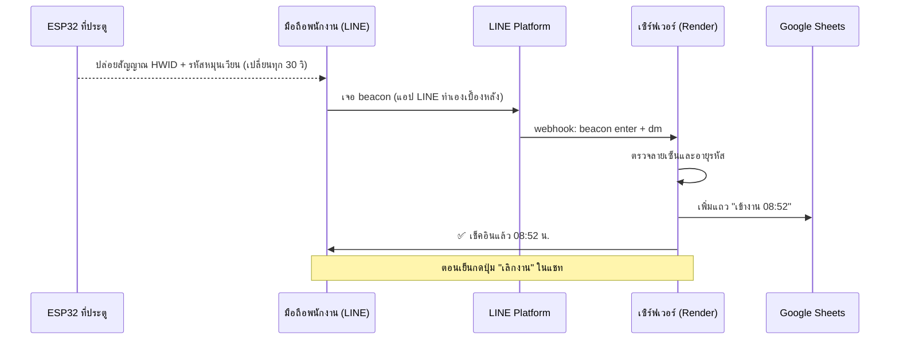

# ระบบเช็คชื่อเข้างานด้วย LINE Beacon

พนักงาน**เดินเข้าออฟฟิศแล้วระบบลงเวลาให้เอง** ไม่ต้องเปิดแอปหรือกดอะไร ใช้แค่มือถือและ LINE ที่ทุกคนมีอยู่แล้ว
ติด ESP32 (ราวตัวละ 150-250 บาท) ไว้ที่ทางเข้าเป็น beacon ข้อมูลไปอยู่ใน Google Sheets ให้ HR เปิดดูได้ทันที

ต่อยอดจากโปรเจกต์ [line-beacon-cafe](https://github.com/Phuparis/line-beacon-cafe)
(ใช้ส่วนขอ token, ตั้ง Webhook อัตโนมัติ และสร้างสัญญาณ LINE Simple Beacon ร่วมกัน)

## ทำงานยังไง



| พนักงานทำ | ระบบทำ |
|---|---|
| แอดเพื่อน LINE OA แล้วพิมพ์ `ลงทะเบียน ชื่อ นามสกุล` (ครั้งเดียว) | จำว่า LINE นี้คือใคร |
| เดินเข้าออฟฟิศ | บันทึกเวลาเข้างาน (ครั้งแรกของวัน) บอกว่าสายไหม |
| กดปุ่ม `เลิกงาน` | บันทึกเวลาออก และชั่วโมงทำงาน |
| พิมพ์ `สถานะ` | บอกเวลาเข้า-ออกวันนี้ |

## กันโกงยังไง

LINE Simple Beacon ปกติปล่อยแค่รหัสเครื่อง (HWID) ซึ่ง**ใครก็อ่านแล้วปล่อยซ้ำจากที่บ้านได้**ด้วยแอปฟรีอย่าง nRF Connect
โปรเจกต์นี้แก้โดยให้ ESP32 ใส่**รหัสหมุนเวียน**ลงในช่อง device message ด้วย หลักการเดียวกับ OTP ของแอปธนาคาร

```
device message 12 ไบต์ = counter (เวลา ÷ 30 วินาที) 4 ไบต์ + HMAC-SHA256(กุญแจลับ, HWID + counter) 8 ไบต์
```

- กุญแจลับ (`BEACON_SECRET`) มีแค่ใน ESP32 กับเซิร์ฟเวอร์ ไม่เคยออกอากาศ
- เซิร์ฟเวอร์รับรหัสที่อายุไม่เกินประมาณ 1 นาที ก๊อปไปใช้ทีหลังไม่ได้
- แก้ counter เองเพื่อต่ออายุไม่ได้ เพราะลายเซ็นจะไม่ตรง
- ตรวจที่เซิร์ฟเวอร์ ไม่ได้ตรวจในมือถือ แก้แอปก็ไม่ช่วย

| วิธีโกง | กันได้ไหม |
|---|---|
| ก๊อปสัญญาณไว้ แล้วไปปล่อยที่บ้านวันหลัง | ✅ กันได้ รหัสหมดอายุ |
| ปล่อย HWID จากแอปในมือถือ | ✅ กันได้ ไม่มีรหัส |
| เพื่อนในออฟฟิศอ่านรหัสแล้วส่งต่อทันที (relay ภายใน 1 นาที) | ⚠️ ยังทำได้ แต่ยุ่งยาก และต้องมีคนช่วยในออฟฟิศ |
| ฝากมือถือให้เพื่อนถือเข้าออฟฟิศ | ❌ beacon ทุกแบบกันไม่ได้ |
| กดเลิกงานจากที่อื่น | ⚠️ บันทึกได้ แต่ในชีตมีช่อง "เห็น beacon ล่าสุด" ให้ HR เทียบ |

## ลองโดยไม่มีอุปกรณ์

ตั้ง `SIMULATOR_ENABLED=true` แล้วเปิดลิงก์เซิร์ฟเวอร์ จะเจอหน้าจำลองผังออฟฟิศ
กด "เดินเข้าออฟฟิศ" แล้วข้อความจะเด้งเข้า LINE จริง และมีปุ่มสีแดงให้ลองโกงด้วยสัญญาณที่ก๊อปไว้

**ตอนใช้งานจริงกับพนักงานให้ปิด** (`false`) ไม่งั้นใครเปิดลิงก์ก็กดเช็คอินแทนคนอื่นได้

## ตั้งค่า

### 1. LINE Official Account
ทำตามขั้นตอนเดียวกับ line-beacon-cafe: สร้าง OA, เปิด Messaging API, จด **Channel ID** และ **Channel secret**
ปิดข้อความตอบกลับอัตโนมัติและข้อความทักทาย (บอทตอบเอง)

### 2. Hardware ID ของ beacon
ขอ LINE Simple Beacon Hardware ID ในหน้า LINE Beacon ของ LINE Official Account Manager (1 ตัวต่อ 1 จุดติดตั้ง)
แล้วใส่ใน `config/beacons.json`

```json
{ "hwid": "ค่าที่ได้", "name": "ประตูหน้าออฟฟิศ", "branch": "สำนักงานใหญ่", "requireToken": true }
```

`requireToken: false` ใช้ทดสอบด้วยแอป nRF Connect เท่านั้น (ปลอมได้) ลบออกก่อนใช้จริง

### 3. กุญแจลับ
```bash
npm run secret
```
ใส่ค่าที่ได้ใน Render (`BEACON_SECRET`) และใน `esp32/attendance_beacon/secrets.h`

### 4. ESP32
1. คัดลอก `esp32/attendance_beacon/secrets.example.h` เป็น `secrets.h` แล้วกรอก Wi-Fi, HWID, BEACON_SECRET
2. Arduino IDE > ติดตั้งบอร์ด **esp32 by Espressif** > เลือก ESP32 Dev Module
3. ถ้าโปรแกรมใหญ่เกิน: Tools > Partition Scheme > Huge APP
4. อัปโหลด แล้วเปิด Serial Monitor (115200) ต้องเห็น `counter ... dm ...` เปลี่ยนทุก 30 วินาที

ESP32 ต้องต่อ Wi-Fi เพื่อดึงเวลาจากอินเทอร์เน็ต (ไม่มีนาฬิกาในตัว) ไม่ได้ส่งข้อมูลพนักงานไปไหน

### 5. Google Sheets (แนะนำ)
Render แบบฟรีลบไฟล์ทุกครั้งที่รีสตาร์ต ถ้าไม่ตั้ง Google Sheets รายชื่อพนักงานจะหาย

1. สร้าง Google Sheet เปล่า 1 ไฟล์ คัดลอก ID จากลิงก์ `docs.google.com/spreadsheets/d/<ID>/edit`
2. [console.cloud.google.com](https://console.cloud.google.com) > สร้างโปรเจกต์ > เปิด **Google Sheets API**
3. IAM และผู้ดูแลระบบ > Service Accounts > สร้าง > แท็บ Keys > Add key > JSON (ไฟล์จะดาวน์โหลดมา)
4. กลับไปที่ชีต กดแชร์ให้อีเมลของ service account (ลงท้าย `iam.gserviceaccount.com`) เป็น**ผู้แก้ไข**
5. ใน Render ใส่ `GOOGLE_SHEET_ID` และ `GOOGLE_SERVICE_ACCOUNT_JSON` (วางเนื้อหาไฟล์ JSON ทั้งไฟล์)

ระบบสร้างแท็บ **พนักงาน** และ **บันทึกเวลา** ให้เอง เขียนแบบ RAW จึงไม่มีใครแอบใส่สูตรผ่านชื่อได้

### 6. Deploy บน Render
New > Web Service > เลือก repo นี้ · Region Singapore · Build `npm install` · Start `npm start` · Instance Free

| Environment Variable | |
|---|---|
| `LINE_CHANNEL_ID`, `LINE_CHANNEL_SECRET` | จำเป็น |
| `BEACON_SECRET` | จำเป็น |
| `GOOGLE_SHEET_ID`, `GOOGLE_SERVICE_ACCOUNT_JSON` | แนะนำ |
| `COMPANY_NAME`, `WORK_START` (เช่น `09:00`) | ไม่บังคับ |
| `SIMULATOR_ENABLED` | `true` ตอนเดโม, `false` ตอนใช้จริง |

เซิร์ฟเวอร์ตั้ง Webhook URL ใน LINE ให้เองตอนเริ่มรัน แล้วไปเปิดสวิตช์ Webhook ใน LINE OA

### 7. บอกพนักงาน
1. แอดเพื่อน LINE OA แล้วพิมพ์ `ลงทะเบียน ชื่อ นามสกุล`
2. เปิด Bluetooth
3. LINE > ตั้งค่า > ความเป็นส่วนตัว > เปิด **LINE Beacon**
4. แจ้งตาม PDPA ว่าเก็บข้อมูลอะไร (ชื่อ, LINE user ID, เวลาเข้า-ออก, สาขา) เพื่ออะไร และเก็บนานแค่ไหน

## ทำไมออกแบบแบบนี้

- **LINE Beacon แทนแอปของเราเอง**: พนักงานมี LINE อยู่แล้ว แอป LINE จับ beacon เบื้องหลังให้ ไม่ต้องทำแอป iOS/Android
- **beacon แทน GPS**: GPS ในตึกคลาด 10-30 เมตร และปลอมง่ายด้วยแอป Fake GPS
- **รหัสหมุนเวียนแทน HWID อย่างเดียว**: HWID ก๊อปได้ในไม่กี่วินาที (ดูหัวข้อกันโกง)
- **รหัสอิงเวลาแทน counter ที่นับเอง**: ESP32 รีสตาร์ตแล้วไม่ต้องจำค่า แค่ดึงเวลาใหม่
- **เลิกงานด้วยปุ่ม**: LINE ยกเลิก event `leave` ไปตั้งแต่ปลายปี 2020 เลยรู้ไม่ได้ว่าคนเดินออก
- **เช็คอินแล้วไม่ตอบซ้ำ**: กันปัญหาข้อความรัวจากโปรเจกต์โรงพยาบาลเดิม
- **Google Sheets แทนฐานข้อมูล**: ฟรี HR ใช้เป็นอยู่แล้ว และเป็นที่เก็บถาวรเมื่อ Render รีสตาร์ต
- **ตอบ 200 ให้ LINE ก่อน, จำ `webhookEventId`**: กัน LINE ส่ง event ซ้ำ

## ข้อจำกัด

- พนักงานต้องเปิด Bluetooth และเปิด LINE Beacon ในตั้งค่า LINE
- ยังไม่รองรับกะดึก (เข้าก่อนเที่ยงคืน ออกหลังเที่ยงคืน)
- Render ฟรีหลับหลังไม่มีคนใช้ 15 นาที event แรกของเช้าอาจช้าประมาณ 1 นาที
- event จริงตอบแบบ reply (ฟรี) ส่วนหน้าเว็บจำลองส่งแบบ push (แพ็กเกจฟรี 300 ข้อความต่อเดือน)

## คำสั่ง

```bash
npm install
npm test                                     # เทสต์ทั้งหมด ไม่ต้องต่อ LINE หรือ Google
npm start                                    # รันเซิร์ฟเวอร์ (ต้องมี .env)
npm run secret                               # สร้าง BEACON_SECRET
npm run beacon:packet -- <hwid>              # ค่าสำหรับแอป nRF Connect (โหมดทดสอบ)
npm run beacon:packet -- <hwid> --secure     # แบบมีรหัสหมุนเวียน ใช้ได้ประมาณ 1 นาที
```

## โครงสร้าง

```
src/beaconToken.js      สร้างและตรวจรหัสหมุนเวียน (ต้องตรงกับ ESP32)
src/eventHandler.js     ลงทะเบียน / เช็คอิน / เลิกงาน / สถานะ
src/attendanceStore.js  สมุดลงเวลาในเครื่อง
src/sheets*.js          เขียนและโหลด Google Sheets (ไม่ใช้แพ็กเกจ googleapis)
src/lineAuth.js         ขอ token จาก Channel ID + secret (จาก line-beacon-cafe)
esp32/attendance_beacon ESP32 ปล่อย LINE Simple Beacon พร้อมรหัสหมุนเวียน
public/index.html       หน้าเว็บจำลอง
```
